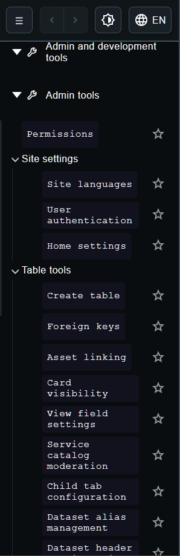

<!-- Coloured_Tool_Navigation.md -->
<!-- Describes the missing group-colour and single-line tool navigation capability. -->
<!-- Connects tool groups, the existing tree, favourites and shared appearance. -->
<!-- Keeps the intended experience independent of implementation details. -->

# Coloured Tool Navigation

Tool entries should be easier to recognise and scan in the menu bar. The missing
capability is a coherent family of coloured icons for each tool group, together
with one line per entry by default. Existing group icons, the tree, collapsing
and favourites provide the structure this extends.

## Group identity throughout the tree

Each tool group (folder) owns a colour family, including groups beneath the
reserved Admin tools and User tools folders. Each final tool entry carries an
icon coloured from its owning group's family. Nested folders keep their place
in the tree and remain collapsible; adding colour must preserve the hierarchy.
A favourite carries the same tool icon and group colour as its entry in the
tree, so its origin remains recognisable outside its folder.

Colour supplements the translated label and recognisable icon shape; it never
becomes the only signal. Text, icons, focus and selection must retain sufficient
contrast in both application themes, including when the application's explicit
theme differs from the operating system's preference.

## Readable entries

Entries use one line by default, including in favourites and with translated
names. A long name may be truncated if the full name remains available to
pointer, keyboard and assistive-technology users, or the available width may
adapt. The icon, label, collapse control and favourite action stay distinct and
usable without flattening the tree.

## Appearance principle

Group colour families come from shared style and appearance tokens, with
appropriate variants for each theme. Individual entries inherit their group's
family rather than hard-coding their own colours. Existing menu accents for
interaction and selection do not yet supply this group identity.

## Illustrative comparison

A reference settings menu has a small coloured icon tile for each category,
with all categories on one level and one line per entry. The intended experience
combines that clarity with Filterest's existing tree and favourites.

The first-party capture below shows today's example: the tree and favourite
stars, without group-coloured tool icons, and some names wrapping onto two
lines. These images are illustrative examples, not a guarantee of the current
state; compare them with the current implementation.

The original mockup shows the intended group colours and single-line entries
inside the tree, with the same colours retained in favourites. Light and dark
examples appear side by side; the colours and names illustrate the principle.

